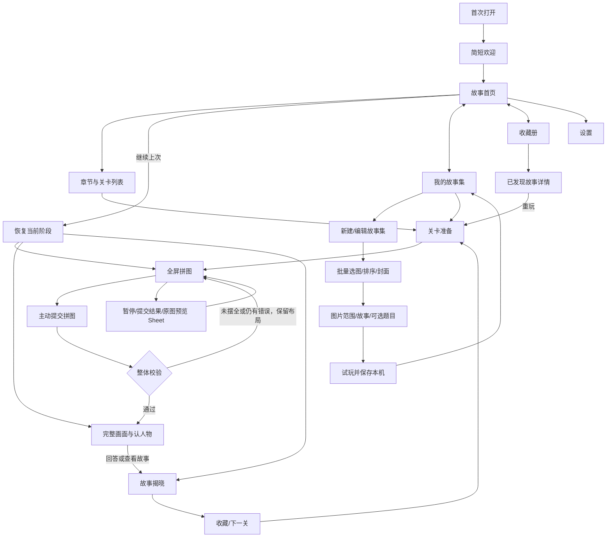

# 《拼见圣经》设计流程与 iOS 页面规划

> 2026-10-13 v0.4：iOS动态系统色；接入用户提供的六张故事插画、欢迎图和图标。玩法改为网格拖动、中性贴格、摆放时不判对错、提交后仅给整体结果，支持12/24/48块和不限次原图预览。图片由用户提供，本次没有调用生图API。

版本：v0.4 · 2026-10-13 · 项目名称暂定

这份稿可交给 UI 设计、插画制作和 iOS 开发作为第一轮工作依据。它包含产品流程、页面规格、关键状态、素材规格与验收顺序。配套 `页面流程原型.html` 是包含用户插画、互补凹凸拼片、手动拖动与提交校验的网页交互演示；它不是可安装的 iOS App。

## 1. 已确定的目标与暂定方向

### 用户已确定

- 做圣经主题小游戏，核心是把碎片拼成完整场景，再识别主要人物。
- 主要给成人玩。
- 素材质量是产品品质的核心，不能只做一个普通棋盘再换人物名字。
- 目前需要具体的设计流程稿与 iOS 页面规划。

### 本稿建议，尚非用户已确认

| 项目 | 第一版建议 | 原因 |
|---|---|---|
| 名称 | 拼见圣经 | 直接表达拼图与发现；上线前还需名称检索 |
| 视觉 | 收藏画册、成熟手绘、iOS 系统背景色 | 适合成人，并给插画留出主导空间 |
| 平台 | iPhone 竖屏优先 | 方便碎片时间游玩；iPad作为适配扩展 |
| 使用场景 | 安静地玩一关，建议目标约3～8分钟 | 时间目标需真实试玩验证，不作为通关要求 |
| 账户 | 无需登录，本地存档 | 先验证内容和游戏体验 |
| 网络 | 首发内容随包内置，可离线完成 | 拼图和揭晓流程不依赖临时网络 |
| 收费 | 暂不在设计中加入付费入口 | 商业模式未确定，先保持核心流程完整 |
| 初始内容 | 先做1个样板关，试玩合格后扩展至6关 | 控制美术返工，避免批量生产错误方向 |

对成人的定位落实在语气、画风和节奏上，不意味着自动提高拼图难度。首次仍提供轻松难度，熟悉后可选更多碎片。


> 最新玩法调整：准备页可预览；游玩中可随时一键查看完整图片。开始后碎片随机打乱，玩家可以边对照原图边拼。无需预览确认，不设置次数或惩罚。人物姓名与故事内容仍在完成后展示。

## 2. 核心体验与产品边界

核心循环：**选择官方故事或自建图片 → 拖动碎片贴入格子 → 主动提交 → 整体通过后认人物（自建可选） → 阅读故事/看图 → 收藏 → 下一幅。**

玩家先获得操作满足，再获得发现人物的满足，最后获得收藏一幅画的满足。原图必须兼顾这三件事：可拼、可认、值得收藏。

### 首版玩法定义

- 在固定画框中放置拼片；拼片不旋转，减少手机上的精细操作负担。
- 用相邻凹凸边界的传统拼图形状；新手教学可使用直边矩形。配套原型已实现同图互补mask、拖动与网格校验。
- 12块＝4列×3行；24块＝6列×4行；48块＝8列×6行；全部共用同一4:3原图。
- 默认12块；准备页可以选择轻松12、标准24、困难48。困难模式提供放大棋盘与滚动浏览。
- 用户拖动到画框格子，自动贴合该格中心；所有格子均能摆放，不判断对错；已摆放片可继续移动或拖回托盘。全部摆放不自动通关。
- 点击“提交拼图”才检查整体。未通过只说明仍有不一致，不标错片、不报告错误数量、不重置布局。通过后才解锁“认一认人物”。
- 拼完后才显示三个候选人物。选择后点击“确认答案”；错误可继续观察或直接查看故事。
- 拼图提交校验通过即达成故事通关。识别正确只是额外发现记录，不成为解锁下一关的硬门槛。
- 无强制计时、排行榜、连续签到、体力条。是否展示本局耗时作为后续偏好项，不放首版主界面。

### 可随时预览，姓名在揭晓后显示

未完成故事使用“故事01”“故事02”等中性名称，题目固定问“画面中的主要人物是谁？”；完成后才展示“摩西·穿过海中的道路”等正式标题。

- 首页、选关、准备页：显示完整故事图片，不出现官方目标人物姓名。用户已明确完整图片优先，不再局部裁切。
- 收藏页：未发现卡片不出现人像、姓名、书卷章节等可能直接给出答案的信息。
- 拼图前：准备页可主动预览完整图片；不先展示人物姓名或选择题。开始后棋盘为空，碎片在托盘随机乱序。
- VoiceOver、分享文本、通知等用户可见信息同样不能提前泄露。
- 拼图中的人物与道具本来就会逐渐给出线索，这是预期体验；不承诺直到最后一块才看出答案。
- 原图预览是常驻功能，点击立即显示完整图片，不二次确认、不限次数、不扣分、不惩罚；允许从画面提前识别人物。猜人物保留为轻量故事学习环节。

## 3. 信息架构与导航

底部设三个根入口：**故事、我的故事集、收藏**。官方精选内容保留原玩法；我的故事集负责创建与编辑；收藏统一回看。设置从首页与收藏页右上角进入。



### 页面清单

| 编号 | 页面 | 展示方式 | 优先级 |
|---|---|---|---|
| P00 | 欢迎与首次教学 | 首次独立页＋首关操作引导 | P0 |
| P01 | 故事首页 | Tab根页面 | P0 |
| P02 | 章节与关卡列表 | NavigationStack推入 | P0 |
| P03 | 关卡准备 | 推入；开始后全屏游戏 | P0 |
| P04 | 拼图 | 全屏游戏内部页面 | P0 |
| P05 | 认人物 | 与游戏共用稳定容器 | P0 |
| P06 | 故事揭晓 | 游戏内部结果页，可阅读滚动 | P0 |
| P07 | 收藏册 | 第二个Tab根页面 | P0 |
| P08 | 故事详情 | 从收藏推入 | P0 |
| P09 | 设置 | 原生Sheet或推入，选一种统一 | P0 |
| S01～S04 | 暂停、提交结果、预览、重开确认 | 原生Sheet/Alert | P0 |
| P10 | 我的故事集 | 第三个根入口 | P0，已实现网页 |
| P11 | 新建/编辑故事集 | 从我的故事集推入 | P0，已实现网页 |
| P12 | 图片与故事编辑 | 从故事集编辑推入 | P0，已实现网页 |
| P13 | 自建故事集详情 | 从我的故事集推入 | P0，已实现网页 |
| P14 | 每日拼图 | 后续可扩展入口 | P1，不展示空入口 |

不新增“商城”“人物百科”“个人中心”等首版空页面。人物介绍由完成后的故事详情承载。

## 4. 完整用户流程

### 4.1 首次进入

1. 系统启动画面显示纯底色与小标志，不设置人为倒计时。
2. 欢迎页说明“拼出画面，发现人物，收藏故事”。主按钮“开始第一个故事”，次按钮“浏览故事”。
3. 进入第一关准备页，默认12块，说明可随时暂停。
4. 进入棋盘后显示“拖动碎片，对照原图；觉得拼好了再提交”。首次引导只教拖动与提交，不演示正确位置。
5. 第一次完成拖动后收起操作教学；不要求用户读完三张教学轮播。
6. 完成后认人物、读故事，回到首页。教学完成状态持久化。

### 4.2 日常打开

- 有未结束的局：首页主要按钮“继续拼图”，附“故事02 · 已摆放8/12”；恢复到准确阶段。
- 上次已拼完但未回答：按钮“继续认人物”。
- 上次在结果页未退出：按钮“查看上次故事”；不会强行重新出题。
- 无进行中的局：按钮“开始下一个故事”。
- 所有首发关卡已完成：按钮“重温已发现的故事”，同时保留收藏入口。

### 4.3 中断与恢复

- 完成移动、回托盘、提交结果、切换阶段、收藏成功时保存；App进入后台再次提交当前状态。
- 来电、锁屏、切后台时结束当前拖拽，将悬浮拼片回到未放置位置，不在恢复时让拼片悬在屏幕外。
- 用户主动返回：自动保存，无需每次弹出“是否保存”。仅对重开/清除进度询问确认。
- 首版只保留一个进行中的局；另开一关前明确说明将替换未完成局，已发现故事和收藏保留。
- 存档校验失败时提供“重新开始这一关”和“返回故事库”，只重置本局，不清空全部收藏。

### 4.4 回答错误与不熟悉圣经

- 先选一个选项，再点击“确认答案”；避免手指误碰立刻判错。
- 错误文案：“再观察一下他手中的物件。”已经错选的选项标“再想想”，可换答案。
- “查看故事”始终可用；点击直接揭晓，不把学习过程做成无法继续的测验。
- 不使用明显荒诞的干扰项。三个候选均为真实人物，名字长度和排列不透露正确答案。
- 正确选项位置按本局打乱并存入状态；恢复页面不重新改变选项顺序。

## 5. iOS 页面详细设计

所有尺寸为设计起点，单位pt；实际实现尊重安全区、Dynamic Type和设备大小。基准画布393×852，小屏检查375×667和320宽度。阅读页面滚动，拼图页面先安排棋盘与操作空间。

### P00 欢迎与首次教学

**目的：**让用户快速明白玩法，并进入第一关。

从上到下：系统安全区；小型标志与暂定名称；一幅不对应待猜人物的封面插画；标题“拼出画面，发现故事”；两行说明；主按钮“开始第一个故事”；文字按钮“浏览故事”。

封面推荐使用画框、桌面、书页等中性主题，不抢先曝光首关完整场景。首次画面适度精致，避免长篇宗教说明或强制登录。无定位、照片库等权限请求。

**状态：**首次、已跳过教学、启动资产读取失败。资产失败仍允许进入内置故事库，不用无限加载占满屏幕。

### P01 故事首页

**目的：**打开后知道下一步玩什么。

```text
安全区
拼见圣经                         设置
今天，拼一个故事

┌──────────────────────────────┐
│ 当前故事完整封面 4:3          │
│ 可以对照完整原图      │
└──────────────────────────────┘
故事02                  已摆放8/12
一句轻说明
[继续拼图 / 开始下一个故事]

故事篇章              查看全部
第一辑 · 发现与旅程          已完成2/6

最近收藏（最多2项，有收藏时展示）
故事          我的故事集          收藏
```

- 封面与主按钮共同指向同一局，避免两个并列“开始”动作。
- 标题28pt，主要封面接近内容宽；主按钮高52pt。
- “第一辑·发现与旅程”是内容包名称，不冒充书卷顺序，也不是人物的重要性排名。
- 初次没有收藏时，不展示一大片空卡片；保留底部收藏Tab即可。
- 首页滚动时，导航与Tab保持原生行为；不放浮动音量按钮遮住图片。

### P02 章节与关卡列表

**目的：**知道有哪些故事以及自己的进度。

导航“故事篇章”；顶部章节名称、两行说明和“已完成2/6”；下方单列故事封面列表。

每项有：故事序号/完成后的故事名、缩略图、难度摘要、状态。各状态封面展示完整图片；官方未完成仍只显示编号，完成后显示人物名；自建图片使用作者标题。

推荐**顺序解锁**：首关可玩，完成一关解锁下一关；不因答错锁住后续。后续可加入自由游玩模式，但首版只有一套规则。

| 状态 | 标签 | 点击行为 |
|---|---|---|
| 可开始 | 可拼 · 12块 | 进入准备页 |
| 进行中 | 继续 · 8/12 | 恢复本局 |
| 已完成 | 已发现 | 进入故事详情；详情中可重玩 |
| 未解锁 | 完成前一个故事后开启 | 保持当前页，说明解锁条件 |

不可玩项有锁图标和文字，而不是只降低透明度。首版只有一个章节时不放无效的章节切换器。

### P03 关卡准备

**目的：**确认所选故事、难度和是否继续旧局。

顶部返回；“故事02”；完整封面4:3；说明“拼完画面后，猜一猜其中的人物”；难度选择；辅助说明；底部主按钮。

- 难度：`轻松 · 12块`、`标准 · 24块`、`困难 · 48块`。显示的是拼片数量，不用模糊星级。
- 首次默认12块；以后记住最近选择，但进行中的局保持原难度。
- 有本关存档：主按钮“继续拼图”，次按钮“重新开始”；改难度需要确认重开。
- 已完成重玩：可展示完整封面，因为人物已经发现；说明“重温这一幅画”。
- 不显示人物姓名、正式故事标题或经文章节。
- 首版原图预览免费；说明“需要时可不限次查看原图，摆好后主动提交”。

### P04 拼图：核心页面

**目的：**让手指能准确抓取拼片，画面逐渐清晰，减少工具干扰。

```text
关闭           故事02             暂停
已摆放8/12                 进度细线

┌──────────────────────────────┐
│                              │
│   4:3网格，任意格可拖入碎片     │
│   无文字/按钮覆盖画面         │
│                              │
└──────────────────────────────┘

剩余4块
┌──────────────────────────────┐
│ 四列多行托盘，独立滚动查看 │
└──────────────────────────────┘

查看原图                 提交拼图
系统底部安全区
```

#### 空间分配

- 画框4:3，12块4列×3行、24块6列×4行、48块8列×6行。显示格子线，不显示答案编号或底图。
- 托盘改为四列、多行，视窗约218px可见四行；所有剩余碎片都在其中，向下滚动查看更多。取消每页只显示六块的分页方式。
- 困难模式可放大棋盘到至少640px，单格80px；棋盘与托盘独立滚动，不撑破手机页面。
- 查看原图和提交都有入口。全部摆放N/N仅表示格子已占，不代表答案正确。

#### 拖动与中性贴格

1. 超过约6pt门槛抓起；触屏悬浮片上移28px减轻遮挡。一次只抓一块。
2. 释放在画框内，根据释放点落入的格子自动贴到中心。正确、错误格均用同样逻辑，不比较答案，不给对错反馈。
3. 一格一片。画框内拖动到已占格：两片互换；托盘片拖入已占格：新片入格，旧片回托盘。此规则与答案无关。
4. 拖回托盘可取下；放到画框和托盘之外、手势取消则恢复原格，不丢片。
5. 算法保存pieceID→slotID与层级；放大和滚动不改变格子。原图、mask与网格共用同一坐标系。
6. 键盘/原生无障碍按同样原则：Enter入中间格，方向键换到相邻格，Delete回托盘；不提供正确格导航。
7. 旧自由坐标存档按所在格子中性迁移；发生冲突时后处理的片退回托盘。已完成与收藏保留，迁移不读取正确答案。

#### 对照原图

准备页和游玩页显示/预览同一完整图片，不用局部裁切。预览无限次、免费、无惩罚；可放大查看，关闭后保持格子摆放、托盘乱序和滚动、棋盘放大与滚动位置。

#### 提交与完成

- 未摆全：请继续放入剩余碎片。
- 摆全但有错误：只报告整体仍有不一致，不标错误格、不报错误数量，全部布局保留。
- 网格贴合后按slotID与目标ID校验，免除细微坐标误差与人为容差。
- 提交通过后官方进入认人物→故事→收藏；自建默认整图/故事，启用题目才先答题。摆放最后一片不会自动通关。


### P05 认人物

**目的：**从完整图里找线索，完成一次轻量人物识别。

顶部“发现人物”；完整插画4:3；问题“画面中的主要人物是谁？”；三个全宽选项；底部主按钮“确认答案”，辅助“查看故事”。图片可点开放大，三个选项各至少52pt，姓名完整显示。

- 未选择：确认按钮禁用；无需默认选中第一项。
- 已选择：描边、选中标志和文字语义一起变化。
- 错误：已选项标“再想想”，显示一句指向画面物件的线索；保持完整图可查看，允许再选。
- 正确：短暂显示“是摩西”＋勾选，随后由明确按钮“查看故事”进入结果；不自动快速跳页。
- 查看故事：直接揭晓，记录为已完成、未答对，不记录为失败。
- 候选项须与故事相符且不重复；正确答案只有一个。多主角场景要提前确定题目指向，例如“拿着手杖的人是谁？”避免歧义。

### P06 故事揭晓

**目的：**让玩家把刚才拼的画与人物故事联系起来，并愿意收藏。

顶部小文案“你发现了”；正式人物名；故事标题；完整插画；80～140字故事概述；经文出处；底部“收藏这个故事”/“已收藏”；主要“下一个故事”，次要“返回故事库”。内容超过屏高时自然滚动。

推荐示例，属于概述，不是经文逐字引用：

> **摩西 · 海中的道路**  
> 以色列人来到海边，前方是海水，后方有追兵。摩西按照上帝的吩咐向海伸杖，海水分开，百姓走在干地上经过。他们在艰难处境中经历了出路。画面以手杖、两侧海水和行进的人群作为识别线索。  
> 出处：出埃及记14:15–31。

“上帝/神”等用语按选定译本与内容口径统一。首版先展示概述和经文出处；逐字经文等译本和使用条件确定后加入，不拼接不同译本。

- 拼完即成为“已发现”；收藏是用户明确动作，首页“已发现数量”和“收藏数量”分别计算。
- 首次收藏显示“已加入收藏”，按钮变“已收藏”。反复点击不创建重复记录。
- 如果用户已发现同人物的另一故事，收藏仍按故事存，不把不同场景覆盖成一个人物卡。
- 最后一关的主按钮改为“打开收藏册”，不出现不可点的“下一关”。

### P07 收藏册

**目的：**像翻画册一样回看已收藏的作品，也能找到未收藏的已发现故事。

顶部“我的收藏”和设置；数量“收藏2幅 · 已发现3个故事”；分段“收藏 / 全部故事”；图片主导的双列网格。小屏或大字体切单列。

- 收藏分段：只展示收藏项目；无收藏时说明“拼完一个故事后，可以把它收进这里”，按钮“去拼一个故事”。
- 全部故事：已发现显示完整封面和名字，未发现显示中性占位与“故事04 · 尚未发现”。
- 按故事编号排序，避免首次收藏反复改变版面；不把“最近收藏”当作默认排序必须项。
- 每格：4:3图片、人物名、单行故事名；图片本身不烘焙星级或进度徽标。
- 首版6关不需要搜索、标签筛选和复杂人物关系图。

### P08 故事详情

**目的：**回看完整插画与内容，管理收藏和重玩。

顶部返回与收藏按钮；插画大图；人物名和故事标题；故事概述；经文出处；“重新拼这幅画”主按钮。点击图片进入可放大的全屏看图，退出回到原滚动位置。

- 重玩进入P03，保留首次完成记录和收藏；重玩中途离开不撤销原解锁。
- 收藏按钮切换收藏状态；这是可恢复操作，直接更新，不每次弹确认框。
- 首版不申请保存图片到相册。分享卡片是后续功能，且只有已揭晓故事可以分享人物名。
- 全屏看图支持双指缩放与双击适配；阅读正文不与图片缩放手势抢占。

### P09 设置

**目的：**管理体验偏好并清楚了解存档与内容。

分组：游玩体验、阅读与无障碍、关于。

| 项目 | 首版默认 | 说明 |
|---|---|---|
| 音效 | 开 | 使用系统静音策略；没有背景音乐也不显示音乐开关 |
| 触感反馈 | 开 | 系统支持时生效；关闭不影响状态识别 |
| 拼图操作 | 手动拖动＋键盘换格 | 不使用点选后放到指定正确位置 |
| 减少动态效果 | 跟随系统 | 显示当前状态；用户可额外减少，不覆盖系统减少设置 |
| 字体大小 | 跟随系统 | 说明支持系统文字大小，无需自造字号滑杆 |
| 内容说明 | 查看 | 说明概述与经文出处口径，插画为艺术化表达 |
| 隐私与本地存档 | 查看 | 准确描述实际实现；没有埋点时不假写数据收集 |
| 清除本地进度 | 单独危险操作 | 明确会删除本地收藏、完成记录与未完成局；二次确认 |

深色模式作为原生页面规划项：若首版没有完成深色验收，就不提供无效主题选项；拼图图片本身不自动变色。关于页有实际版本号和素材说明，不放虚构评分与用户数。

## 6. 弹层与异常状态

| 场景 | 内容 | 主操作 | 恢复规则 |
|---|---|---|---|
| 暂停 | 已摆放8/12，进度自动保存 | 继续拼图 | 返回原棋盘；暂停期间无计时要求 |
| 离开 | 自动保存后直接退出 | 无多余确认 | 首页恢复到原阶段 |
| 重开本局 | 将清除本关未完成进度，收藏保留 | 重新开始 | 新种子/新顺序；取消保持旧局 |
| 另开一关 | 首版仅保留一局，旧未完成局将替换 | 开始新故事 | 已完成和收藏保留 |
| 提交拼图 | 整体通过或仍有错误 | 认人物/继续调整 | 不指认错误块；失败保持布局 |
| 原图预览 | 点击立即显示完整画面，可随时打开，不限次数 | 返回拼图 | 返回不移动棋盘、不重排碎片，不改变发现与收藏记录 |
| 内置图片读失败 | 这幅画暂时无法打开 | 重试 | 保留存档，可返回列表 |
| 空收藏 | 尚未收藏故事 | 去拼一个故事 | 不伪造内容填充 |
| 存档不兼容 | 本局进度无法恢复，已发现故事仍保留 | 重开这一关 | 只重置当前局；记录可诊断信息 |
| 清除全部进度 | 此设备上的发现记录、收藏和未完成局都会删除 | 清除进度 | 取消退出；执行后回欢迎/首页 |
| 无网络 | 首版内置故事可继续玩 | 正常操作 | 不显示阻断式离线错误 |

界面禁止“看起来可点却无行为”的按钮。加载状态不与空状态混用：加载显示短进度，空收藏说明原因，错误给恢复路径。

## 7. 素材制作规划：先做样板，再铺开

### 7.1 统一美术方向

推荐成熟手绘故事插画：中等细节、清楚的前中后景、温和自然光、稳定笔触；人物有可信体态，配色随场景变化但整体饱和度与材质统一。正式画风仍需要用户参考或样稿审阅确认。

每幅画遵守：

1. **拼图可辨识：**各区域有不同轮廓、纹理或色块；避免超过约20%的画面成为同质天空/沙地，此比例是初始制作目标，需试玩验证。
2. **人物可识别：**用动作和场景线索识别，不依赖每个人脸上的细微区别。
3. **画册可收藏：**完成后整图构图成立，不能只为拼片堆满无关物件。
4. **故事准确：**人物、器物和事件属于同一故事阶段；不把不同年代元素随意混合。
5. **视觉统一：**同一主角跨场景时保持面貌、服饰基本语言；光源、笔触、细节密度有同一套标准。

### 7.2 第一关样板推荐：摩西与海中的道路

这里以故事02作为界面示例编号；正式样板可以安排为第一关，编号最终由内容编排统一。

- 横向4:3场景：两侧海水、中间道路、近景摩西与手杖、远处行进人群。
- 海水不是整片同色，要有自然波纹、明暗和不同轮廓；道路有脚印、石块等叙事合理细节。
- 主角占画幅高度约30%～45%，放在中间安全区域；全图能识别而不挤成单个人像。
- 中央1:1安全裁切保留主角与核心线索，供需要方图的收藏/分享扩展；正式页面优先保持4:3完整画幅。
- 拿手杖的动作与人物手部要修正，远处人群保持自然比例；不生成文字标签。
- 一幅图同时测试12、24和48块；插画没通过裁切试玩前不开始批量生产其他图。

### 7.3 首发六关建议

章节名“发现与旅程”，是一组故事选集，不声明严格时间顺序。

| 故事 | 目标人物 | 场景线索 | 原图制作难点 | 出处建议 |
|---|---|---|---|---|
| 方舟与归来的鸽子 | 挪亚 | 方舟、鸽子与橄榄叶 | 本场景在洪水之后，不混入正在登舟的成对动物作为同一时刻 | 创世记8:6–12 |
| 海中的道路 | 摩西 | 手杖、分开的海、行进人群 | 大片水面要有可拼纹理，主角指向明确 | 出埃及记14:15–31 |
| 少年与巨人 | 大卫 | 投石索、少年、远处对手 | 体型比例、衣服时代一致，画面保持非血腥叙事 | 撒母耳记上17章 |
| 麦田里的拾穗者 | 路得 | 麦穗、拾穗动作、田野 | 不只靠性别认人；题目和候选要给合理线索 | 路得记2章 |
| 狮子之间 | 但以理 | 狮子、洞穴、平静人物 | 暗场仍要可辨；狮子姿态与数量自然 | 但以理书6章 |
| 王宫中的请求 | 以斯帖 | 王宫、王后、伸出的金杖 | 王宫与衣饰需认真参考；避免泛化为欧洲宫廷 | 以斯帖记5:1–3 |

制作前对照经文核对情节；完成后由熟悉内容者审阅。这里的顺序可按难度与画面变化调整，不按人物地位排序。新约场景可以后续单独形成内容包。

### 7.4 资产清单与规格

| 资产 | 建议交付 | 用途/注意事项 |
|---|---|---|
| 场景母版 | 3200×2400px或更高，sRGB，无字，无卡框 | 每故事1幅；保留可编辑源与修图记录 |
| 运行时场景 | 1600×1200px起，JPEG/HEIF按设备验证 | 大图与棋盘；不直接加载所有母版到内存 |
| 列表封面 | 800×600px，4:3 | 已发现时展示完整构图 |
| 未完成封面 | 同一完整原图的等比缩略图 | 官方未完成只隐去姓名，完整画面不裁切 |
| 人物局部裁切 | 从同一母版派生 | 需要时用于题目或详情，保持角色一致 |
| 拼片形状 | 程序生成mask/矢量路径 | 相邻凸边凹边必须互补；不要分别生成12张不连续的碎片图 |
| UI图标 | 原生SF Symbols | 单一风格；不把Unicode符号当最终图标 |
| App图标 | 1024×1024px设计母版，按当前Xcode资产要求交付 | 小尺寸仍可识别；从画框/拼片的组合探索，暂不作为定稿 |
| 封面插画 | 中性主题，匹配场景笔触 | 欢迎页；不预告待猜答案 |
| 音效 | 中性拿放、完成、收藏3种 | 音量一致，来源与使用条件清楚 |

6幅3200×2400 RGBA全部解码约184MB，故只加载当前故事，列表使用缩略图；拼图共用同一场景纹理与mask，避免每块都复制一张全尺寸图。导出压缩后检查颜色、锐度和小碎片细节，不能只看高清母版。

### 7.5 素材验收流程

方向说明 → 低成本构图草稿 → 单幅正式插画 → 人物/故事审阅 → 12块裁切试玩 → 24块裁切试玩 → 手机原尺寸检查 → 图鉴与列表缩略图检查 → 修图与统一色彩 → 批量扩展。

样板关必须通过：

- 近景人物手部与道具无明显错误；关键线索不含糊。
- 同一画面不存在大面积几乎相同的碎片，试玩时不需要长期靠试错。
- 4:3原图、列表封面、可选方形裁切都不切断关键人物。
- 参与试玩的人能解释自己用了哪些线索；不熟悉故事者也能通过揭晓理解答案。
- 至少邀请5位成人做一轮探索性试玩；这是发现问题的起点，不是统计显著性验收。
- 用真实手机看运行时压缩图与拖动，不把桌面高清预览视为最终通过。

**当前状态：用户提供素材已接入网页，见八张素材验收意见；原生实机与发布母版待验收。** 本稿给的是制作与验收标准，不声称已有可商用美术。

## 8. 设计与开发交接

### 必须统一的状态

每个故事分为：locked / available / inProgress / completed；收藏另记布尔值；人物识别另记 unanswered / incorrect / correct / revealed。拼图完成不等于主动收藏。

本局保存：storyID、难度、拼片布局种子、每片slotID与层级、托盘顺序及滚动位置、棋盘缩放和滚动、当前阶段、选项顺序、所选答案、是否看原图、提交次数、最近提交结果、最后更新时间、内容版本。种子保证同一局恢复后拼片边界不改变。

内容配置至少包含：storyID、未发现名称、揭晓标题、目标人物、三个候选、场景资源名、未发现封面、简介、经文出处、图像裁切焦点、辅助描述、内容版本、素材来源说明。人物名和答案只在允许的页面输出。

### 原生实现建议

SwiftUI负责导航、设置、列表与阅读；棋盘用同一坐标系管理场景、mask与拖动。12/24/48块不要求引入重型3D引擎。若选SpriteKit实现棋盘，把它嵌入SwiftUI容器，导航与存档仍保持统一。

图像与mask共用布局基准；旋转/尺寸变化时重新计算显示坐标，存档保存逻辑位置而不是屏幕像素。内容与进度分开，更新资源包时通过storyID迁移；一次更新不能让收藏自动丢失。

### Figma或设计文件组织建议

- 00 Brief：目标、假设、流程与未决项。
- 01 Foundations：颜色、字体、尺寸、动效与无障碍。
- 02 Components：按钮、封面、托盘、选项、Sheet及全部状态。
- 03 iPhone Screens：P00～P09，基准尺寸与小屏。
- 04 Flows：首次、恢复、错误回答、完成、收藏和重玩。
- 05 Art：母版、裁切、关卡素材清单；与页面标注分开。
- 06 Handoff：状态字段、资源命名、验收检查。

本次未创建Figma文件；以上是后续设计文件结构建议。

## 9. 工作顺序与阶段交付

| 阶段 | 实际工作 | 交付/完成条件 |
|---|---|---|
| A 方向确认 | 核对成人定位、画册方向、12/24/48块、提交与解锁规则 | 本流程稿审阅；未决项记录清楚 |
| B 样板素材 | 摩西场景草稿与正式样稿，做两个难度裁切 | 手机看图与裁切试玩通过 |
| C 关键页面 | 优先P04拼图、P05认人物、P06揭晓、P07收藏 | 用同一正式样稿串起闭环，检查画面占比 |
| D 首个原生闭环 | 1幅图、真实拼片mask、中性贴格与提交校验、题目、收藏与恢复 | 真机完整通关、中断可恢复 |
| E 六关内容 | 按统一规范扩展插画与故事 | 每关内容审阅、猜人物无歧义、性能合格 |
| F 发布准备 | 补全首页、设置、无障碍、隐私说明与资产 | 检查矩阵通过，再准备上架素材 |

不写未经验证的开发工期。素材质量、是否有Mac与iOS签名环境、开发基础会影响排期。第一轮最重要的投入是样板插画与核心拼图页，而不是先画一套几十页的复杂界面。

## 10. 验收检查矩阵

| 类型 | 必查场景 | 通过标准 |
|---|---|---|
| 首次游玩 | 不熟悉产品的成人开始第一关 | 不读长教学也能理解抓取/放置 |
| 小屏 | 375×667，另检查320pt宽 | 棋盘与当前托盘可用，按钮≥44pt，无关键内容遮挡 |
| 大屏 | 393×852与较大iPhone | 留白自然，图片比例一致 |
| 文字大小 | 标准与辅助功能大字 | 问题和人物名完整，结果页可滚动 |
| 手势 | 抓取、错误释放、边缘、托盘滚动、多指 | 不丢片、不误翻页、不误触退出 |
| 存档 | 每个阶段切后台与强制结束后重开 | 已保存阶段恢复一致；损坏有局部恢复路径 |
| 识别 | 错选、再选、直接揭晓 | 均可继续；选项不变动；不会提前透露答案 |
| 无障碍 | VoiceOver移动动作、键盘换格、Reduce Motion | 控件可读可操作；另评估文字线索替代体验 |
| 素材 | 原图、运行图、12/24/48块、缩略图 | 关键线索保留，碎片不大面积同质 |
| 声音与触感 | 系统静音、开关关闭 | 关闭后状态仍明确 |
| 离线 | 飞行模式启动与完成一关 | 内置内容与收藏不依赖网络 |
| 资源 | 连续进出6关 | 当前图释放，内存无持续增长，拖动流畅 |
| 内容 | 逐关经文出处和概述审阅 | 人物唯一、场景阶段一致、译本口径统一 |

本次验收范围是文档、设计契约和网页流程原型。原生真机、原生拼片性能、发布母版与内容专家审阅均是后续验收项，不能用原型检查替代。

## 11. 配套文件与当前完成度

- `页面流程原型.html`：浏览原有10页及4个自建页面、查看关键弹层、演示题目与结果路径；无外部依赖，离线打开。
- `docs/design-system/manifest.json`：机器可读设计契约。
- `docs/design-system/design-system.md`：视觉、尺寸、iOS布局和无障碍规则。
- `docs/design-system/component-map.md`：可复用组件与状态。
- `docs/design-system/reference-board.md`：参考来源、方向比较与知识覆盖限制。
- `AGENTS.md`：继续开发时遵守设计契约的项目说明。

待确认：最终名称、正式美术参考、经文译本、最低iOS版本、首发实际关卡数、iPad是否首发、商业模式。

下一步：使用已接入素材在iPhone验证48块的缩放与抓取、验证任意格一致贴合与提交格子校验；针对大卫投石索、但以理暗区做定向精修。

## 12. 自建故事集与追加需求 · v0.4

项目暂名《拼见圣经》；英文名建议Bible Story Puzzle，GitHub仓库名建议bible-story-puzzle。项目仓库：https://github.com/iszkq/bible-story-puzzle；v0.5新增iOS混合应用工程与未签名构建流程。新增功能不是来自既有GitHub项目的分支。

用户已授权实现本机创作版。完整页面、数据版本和原生开发交接见《自建故事集与网格玩法规划.md》。网页已接入创建、批量导入、图片范围调整、排序、自选封面、故事文字、可选题目、三档试玩、保存、编辑、删除、收藏、旧版本继续与草稿恢复。远程分享、跨设备同步和公开社区留待后续阶段。

新增验收：完整原图不被局部裁切；12/24/48格正确显示；任何格子一致吸附；占格处理不丢片；错误只在提交出现；托盘四行以上并可浏览全部片；上传图与预览/拼片一致；照片不拉伸；导入失败、存储满、草稿恢复、替换版本和删除后的历史收藏均有明确行为。
